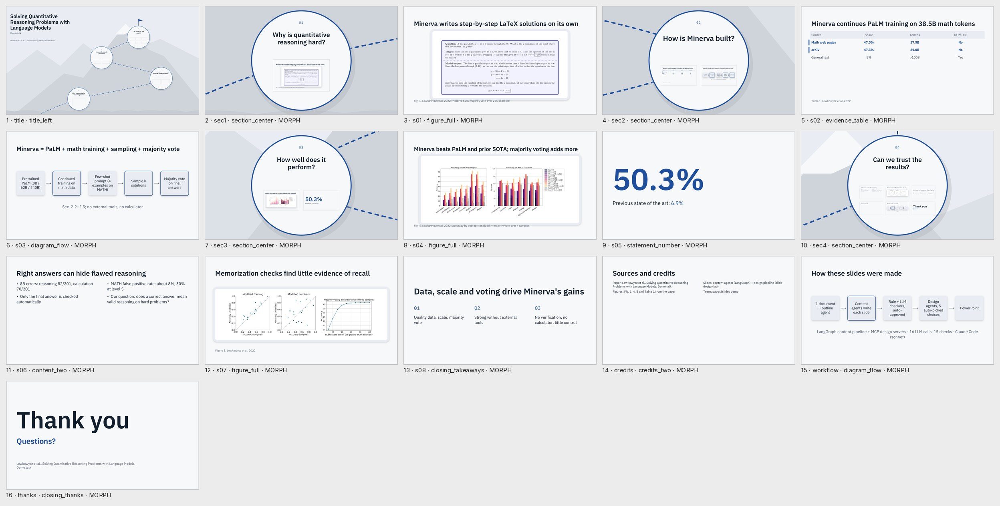
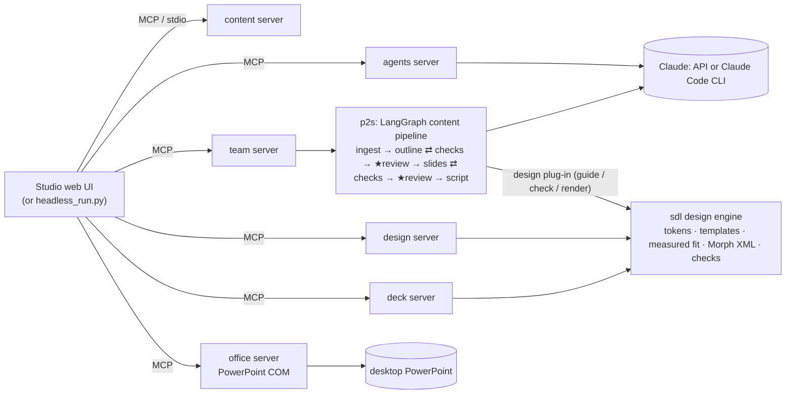

# paper2slides · Slide Studio

**Source-grounded presentation generation: a research paper in, an editable, checked PowerPoint talk out.**

LLM agents plan the talk and write the slides; deterministic checks hold every slide to the source
documents and to the measured space on the slide; a person makes the design decisions from real rendered
options. The result is a native `.pptx` (editable text, native charts and tables, Morph transitions, speaker
notes) plus PNG/PDF renders made by PowerPoint itself.



*The demo deck: Lewkowycz et al., "Solving Quantitative Reasoning Problems with Language Models"
(arXiv:2206.14858, CC BY 4.0), 16 slides, every image rendered by desktop PowerPoint. This deck comes from a scripted run, so the design
options were auto-picked (first option each time) and the reviews auto-approved; the deck says so itself. The deck:
[`examples/minerva/minerva.pptx`](examples/minerva/minerva.pptx).*

**What was measured** (one paper, two live runs, [`eval/`](eval/)): with the checking loops on, the deck had
**0 numbers missing from the source** (23 checked), **0 maths-markup errors**, **0 measured layout errors**, and
99.5 % of the slide text was native, editable PowerPoint text. The checked run cost ~$1.25 of API-equivalent
model time for the content step (Claude Code CLI, Sonnet), against ~$0.69 for one-shot generation, which left
one table cell overflowing. Details, method and the caveats are [below](#evaluation).

---

## What is LLM, what is checked, what is human

| Step | Who does it | What keeps it honest |
|---|---|---|
| Read the paper (+ any extra documents with a role and a comment) | PDF text + figure extraction (PyMuPDF) | figures are cropped with their captions, panel titles and axis labels |
| Talk brief: claim, audience, mood | LLM (theme agent) | JSON schema; shown to the person |
| Slide count, talk length, text density | **human** (kick-off) | turned into per-slide-type character limits |
| Palette → type → graphics → shapes → main style | LLM proposes 4 options per stage, **human picks** | every option is validated (contrast, installed fonts, distinct) and rendered by PowerPoint before the choice |
| Outline | LLM (content pipeline) | exact slide count, known slide types, figures exist; LLM checker for story and document use |
| Slide content | LLM (content pipeline) | character limits, slot structure, `$...$` maths markup, **text fit measured with the chosen fonts**, **every number must occur in the sources**; LLM checker for faithfulness; failures go back to the writer (≤ 2 rounds) |
| Two review pauses (outline, slides) | **human** approves or asks for changes | LangGraph `interrupt()`, checkpointed |
| Presenter script | LLM | one entry per slide, 85–105 % of the talk length, words per minute |
| Deck look (motion, grounds, canvas world) | LLM motion director proposes, **human picks** | 4 near-final decks rendered as PowerPoint video |
| Layout | deterministic template library (12 slide types, 21 variants) | overflow, bounds, overlap, contrast, font size, glyph coverage, font audit of the saved `.pptx` |
| Visual review | LLM judge looks at the PowerPoint renders | its layout fixes are applied only if no visible word is lost (see [below](#a-finding-from-building-the-evaluation)) |

An LLM judge's score is reported as a signal, never as a quality certificate.

## Architecture



- `studio/` — Slide Studio: web UI (`webapp/`), six MCP servers (`mcp_servers/`), the design engine
  (`src/sdl/`), agent prompts (`src/agents/prompts/`), fonts (SIL OFL), offline replay data (`replay/`).
- `p2s/` — the LangGraph content pipeline (nodes, deterministic checks, contracts, LLM providers), usable on
  its own from the command line or an OpenClaw skill (`openclaw/`).
- `design/render.py` — the plug-in that connects p2s to the design engine.
- `eval/` — the evaluation script and its saved results.

## Author and credits

By **Áron Bán-Szabó**: the Slide Studio and the design side — the design engine (`studio/src/sdl/`:
design tokens, template library, measured text fit, Morph/zoom/canvas-world motion, deterministic checks,
PowerPoint COM rendering), the MCP servers and web UI, the design agents and visual judge, the integration
of the content pipeline (`design/render.py`, the design-aware checks in `p2s/`), the headless runner and
the evaluation.

The project grew out of a course project for *CSC 53432 Large Language Models* (École polytechnique, 2026).
The first version of the LangGraph content pipeline (`p2s/`) was written by Ounsi Kanaan and is included
here with the author's permission. The GeoRA paper (arXiv:2601.09361) served as a worked example there; GeoRA model
training is not part of this repository.

Code was written with heavy use of Claude Code as a coding assistant.

## Quick start

### Requirements

| | Needed for | Notes |
|---|---|---|
| Windows 10/11 + **desktop PowerPoint** (Microsoft 365 / 2019+) | rendered previews, PNG/PDF/MP4 export, the Morph check | PowerPoint is driven through COM. Without it the pipeline still writes the `.pptx`; previews fall back to LibreOffice if installed (no Morph, slightly different font metrics; not tested in this version). |
| Python 3.11–3.13 (3.12 tested) | everything | |
| Claude: **API key** *or* **Claude Code CLI** logged in | live runs only | The offline demo needs neither. |

### Install

```powershell
git clone https://github.com/banszaboaron/paper2slides.git
cd paper2slides
.\install.bat          # .venv + both requirement files + local config files
```

### 1. Offline smoke test (no model, no key, ~1 min)

```powershell
.venv\Scripts\python -m pytest -q
```

Runs the LangGraph pipeline end to end with the deterministic `fake` provider (two human interrupts, a
revision, the final deck) and the design link. This proves the wiring, **not** the quality of any model.

### 2. Offline demo deck (recorded answers, needs PowerPoint, ~2.5 min)

```powershell
scripts\demo.cmd
```

Replays the recorded agent answers of the live Minerva run (`studio/replay/minerva/`) and its checked slide
spec through the same MCP servers, builds the deck, applies the visual judge's fixes and exports PNG + PDF
with PowerPoint. Output: `studio/sessions/minerva/deck/`.

### 3. Live run on your own paper

```powershell
# Claude Code CLI (Pro/Max subscription; counts against the plan's limits):
claude auth login
cd studio
..\.venv\Scripts\python tools\headless_run.py --pdf C:\papers\paper.pdf --session mypaper `
    --llm claude_cli --model sonnet --content team --slides 12 --minutes 15 --judge --export
# Claude API instead: set ANTHROPIC_API_KEY and use --llm anthropic --model claude-sonnet-5-5
```

The headless runner takes the design choices from `--pick palette=<key>,type=<key>,...` or, by default, the
first option, and records which. For the interactive version, run `.\start.bat` and open
http://127.0.0.1:8765 (localhost only).

## Evaluation

Same paper, same design choices, two ways of writing the content (`eval/evaluate.py`, saved results in
[`eval/results/`](eval/results/)):

- **A — single pass:** one LLM call drafts the whole slide spec.
- **B — checked pipeline:** the LangGraph pipeline (outline → checks → per-slide writing → checks → script),
  with the two review pauses auto-approved because the run was scripted.

| Metric | A: single pass | B: checked pipeline |
|---|---:|---:|
| Slides (logical) | 16 | 16 |
| Numbers on slides, checked against the sources | 41 | 23 |
| … not found in any source | 0 | 0 |
| … in the right context (LLM review, see note) | 41 / 41 | 21 / 23 (2 are section numbers, not quantities) |
| Maths-markup errors | 0 | 0 |
| Measured layout errors (text that does not fit) | 1 (a table cell at 119 %) | 0 |
| Slide text that is native, editable PPTX text | 100 % | 99.5 % |
| Native equations (OMML) | 0 | 0 |
| Content step: LLM calls | 2 | 16 |
| Content step: model time | 67 s | 135 s |
| Content step: API-equivalent cost | $0.69 | $1.25 |

How to read it:

- **"Found in the source" is necessary, not sufficient.** A number can occur in the paper and still be used in
  the wrong context. Every number is therefore written to a sheet with the source passage it matched
  (`eval/results/*_numbers.csv`). Those passages were reviewed by an LLM (Claude Opus), **not by a person**;
  the sheets have `verdict / reviewer / note` columns for a human review, which has not been done yet.
- **Costs are estimates.** The runs used the Claude Code CLI on a subscription; the cost is the
  API-equivalent figure the CLI reports, not money spent.
- **n = 1 paper.** This shows the method and the tooling, not a statistically meaningful comparison. The
  single-pass deck is not bad: on this paper the main measurable difference is layout (the checked run
  measures text fit with the chosen fonts and rewrites what does not fit) and fewer, better-anchored
  numbers.
- The visual LLM judge scored both decks 6/10. That is reported as a signal only.

## A finding from building the evaluation

The visual judge looks at the PowerPoint renders and proposes fixes, mostly "use layout variant X for this
slide". On an earlier replay run on another paper, these swaps **silently dropped content**: the headline
number of a statement slide disappeared, and a three-column comparison became a two-column one. Every
deterministic check still passed, because everything that was *left* on the slide fitted.

The fix (`apply_fixes` in `studio/src/sdl/service.py`): before a variant swap is accepted, the slide is laid
out both ways and the visible words (text, chart and formula labels) are compared; a swap that loses any
word is rejected and logged. In the two Minerva runs the judge proposed 8 and 10 fixes, all passed this
check. The lesson generalises: an LLM reviewer's edits need the same deterministic guarantees as the
writer's.

## Limitations

- **Windows + desktop PowerPoint** for the renders, the PNG/PDF/MP4 export and the Morph transitions.
  Without PowerPoint the `.pptx` is still written; the LibreOffice fallback was not tested in this version.
- **Morph**: the deck uses PowerPoint's native Morph transition, and PowerPoint reports it on every slide
  when it exports the deck. The animation itself was not checked frame by frame in a slide show.
- **Display formulas are pictures**, not native Office equations (OMML = 0). Inline maths is native text.
- **Canvas world**: the section overview shows the slides as small thumbnails by design; the visual judge
  calls them illegible, which is fair at a distance.
- **The judge may rewrite short texts** (e.g. a caption). Those edits keep the number check, not the
  context check.
- **Headless runs make no human choices**: the design options are taken from `--pick` or the first option,
  and the review pauses are auto-approved. The deck's own "How these slides were made" slide and the run
  report say so. The interactive Studio is where a person chooses.
- The evaluation is one paper and two runs; see above.

## Licence and attribution

Code: [MIT](LICENSE). Fonts: SIL Open Font License 1.1 (`studio/fonts/licenses/`). Example paper:
CC BY 4.0, see [`examples/papers/README.md`](examples/papers/README.md).
